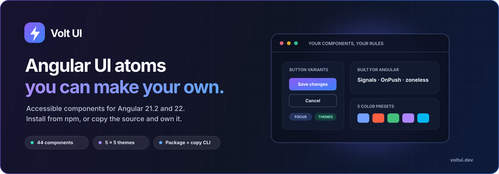

<div align="center">



<br/>

**Accessible, themeable Angular components—install them from npm or copy the source and make them yours.**

Built with signals, Tailwind CSS v4, CVA and [ng-primitives](https://ng-primitives.dev).

<br/>

### ⚡ v1.3 — Async data, Angular 22 and verified behavior

**Volt UI meets real application data.** `volt-combobox` can search a server (`filterMode="manual"`,
`(queryChange)`, `loading`) and breadcrumbs take your own router anchors (`a[voltBreadcrumbLink]`).
**Angular 21.2 and 22 are both supported**, each verified against the packed package in an isolated
project, and every stateful component is exercised in real browsers (Chromium, Firefox, WebKit), not
only in jsdom. Backwards compatible · **[release notes](./CHANGELOG.md)** ·
**[upgrade notes](./MIGRATION.md)** · **[versioning policy](https://voltui.dev/docs/versioning)**

The site is available in **English, Spanish and Ukrainian**, and every component now has an
interactive **[Storybook](https://storybook.voltui.dev)** reference with live controls, all theme
presets and an accessibility panel.

<br/>

[](https://www.npmjs.com/package/@voltui/components)
[](https://www.npmjs.com/package/@voltui/cli)
[](https://angular.dev)
[](https://tailwindcss.com)

[](https://voltui.dev/docs/components)
[](https://github.com/Andersseen/volt-ui/actions/workflows/ci.yml)
[](./LICENSE)
[](https://github.com/Andersseen/volt-ui/stargazers)

<br/>

**[🌐 Live Docs](https://voltui.dev)** · **[📦 Components](https://voltui.dev/docs/components)** · **[🎨 Theme Builder](https://voltui.dev/create-theme)** · **[🤖 AI / MCP](https://voltui.dev/docs/mcp)** · **[📖 Docs](https://voltui.dev/docs/introduction)** · **[📚 Storybook](https://storybook.voltui.dev)**

</div>

---

## 💡 What is Volt UI?

Volt UI is an independent Angular component library **inspired by [shadcn/ui](https://ui.shadcn.com)**.
It provides the **atoms** — buttons, inputs, cards, badges, tabs, form fields, alerts, overlays — and
leaves everything that makes your product yours to your app: layouts, identity, icons, motion,
state and domain components.

There are two first-class ways to use it. Pick per project; both are supported for the whole 1.x line.

|           | **Package mode** — `@voltui/components`              | **Copy-and-own mode** — `@voltui/cli`                 |
| --------- | ---------------------------------------------------- | ----------------------------------------------------- |
| You get   | `VoltButton`, `VoltCard`… imported from npm          | `UiButton`, `UiCard`… copied into `src/app/ui`        |
| Updates   | `npm update` — centralized, one version across apps  | You own the source; re-copy when you choose           |
| Customize | `class` (merged with `cn()`), variants, theme tokens | Edit the component itself                             |
| Best for  | Several apps sharing the same atoms and behavior     | Apps that want full control and no long-term coupling |

- 🎨 Restyle through **Tailwind v4 tokens** and `class` instead of fighting a theming API.
- ♿ Keyboard, focus and ARIA behavior come from ng-primitives, on the native elements you write.

> **Why it exists** — Angular has strong headless and enterprise UI options, but few focused on the shadcn-style _"copy the component and own it"_ workflow. Volt UI fills that gap with modern Angular patterns (21.2+ and 22): standalone components, `OnPush`, signals, zoneless compatibility, `ng-primitives` accessibility behavior, and Tailwind v4 tokens.

> _Naming note: this project is not affiliated with PrimeVue Volt UI. Here, Volt UI is an independent Angular implementation for the `@voltui` packages and CLI._

---

## ✨ Highlights

|                                |                                                                                                             |
| ------------------------------ | ----------------------------------------------------------------------------------------------------------- |
| ⚡ **Package or copy**         | Import from npm for shared updates, or copy the source with the CLI and own it.                             |
| ♿ **Accessible by default**   | Keyboard, focus, and ARIA behavior delegated to [ng-primitives](https://ng-primitives.dev).                 |
| 🎨 **25 theme combinations**   | 5 color × 5 style presets, plus dark mode, driven by Tailwind v4 tokens.                                    |
| 🧩 **44 components**           | Forms, overlays, feedback, navigation, data display — see the [catalog](#-component-catalog).               |
| 📚 **Storybook reference**     | Every component's states, controls, themes and API at [storybook.voltui.dev](https://storybook.voltui.dev). |
| 🛰️ **Zoneless & signal-first** | `input()` / `output()` / `model()` / `computed()`, `OnPush` everywhere.                                     |
| 🤖 **AI-ready**                | An MCP server for the facts, seven focused skills for the decisions, and a prompt reference.                |

---

## 🚀 Quick Start

### Package mode

```bash
npm install @voltui/components @angular/cdk
```

```css
/* styles.css */
@import 'tailwindcss';
@import '@voltui/components/themes.css';
```

```ts
import { RouterLink } from '@angular/router';
import { VoltCard, VoltCardContent, VoltNativeButton } from '@voltui/components';

@Component({
  selector: 'app-example',
  imports: [RouterLink, VoltCard, VoltCardContent, VoltNativeButton],
  template: `
    <volt-card>
      <volt-card-content class="p-4">
        <a voltButton variant="outline" routerLink="/docs">Documentation</a>
      </volt-card-content>
    </volt-card>
  `,
})
export class ExampleComponent {}
```

### Copy-and-own mode

Initialize a local UI folder, then add components:

```bash
# Scaffold ./src/app/ui
npx @voltui/cli init

# Add components (dependencies are copied automatically)
npx @voltui/cli add button card dialog
```

Use the copied components from your app:

```ts
import { UiButton } from './ui/button';

@Component({
  selector: 'app-example',
  imports: [UiButton],
  template: `<button uiButton type="submit">Save</button>`,
})
export class ExampleComponent {}
```

<details>
<summary><b>🛠️ CLI behavior & flags</b></summary>

<br/>

- Copies from `packages/volt/src/lib` into `src/app/ui` by default.
- Transforms `Volt*` → `Ui*` and `volt-*` → `ui-*`.
- Detects and copies local component dependencies automatically.
- Refuses to overwrite existing files unless `--force` is passed.
- `--dry-run` previews files before writing.
- `[target-dir]` sets an alternate destination.
- `--install` installs the required runtime dependencies.

```bash
npx @voltui/cli add button card ./src/app/shared/ui --dry-run
npx @voltui/cli add button card ./src/app/shared/ui --force --install
```

Copied components need these runtime dependencies in the target app:

```bash
npm install ng-primitives class-variance-authority clsx tailwind-merge
```

</details>

---

## 🎨 Theme System

Themes are CSS custom properties mapped into Tailwind v4 via `@theme inline`. Components use **semantic utilities** (`bg-primary`, `text-foreground`, `rounded-md`, `shadow-sm`) instead of hard-coded `var()` utilities — so a preset swap restyles everything.

<table>
<tr>
<td valign="top" width="50%">

**🌈 Color presets**

- `volt`
- `ember`
- `sage`
- `dusk`
- `glacier`

</td>
<td valign="top" width="50%">

**🖌️ Style presets**

- `sharp`
- `soft`
- `brutal`
- `ghost`
- `retro`

</td>
</tr>
</table>

> 🎛️ Mix and match live in the **[Theme Builder →](https://voltui.dev/create-theme)** — generate a
> contrast-checked palette in one click, or import one from
> [Palette Crafter](https://palette-crafter.andersseen.dev).

Custom themes must preserve WCAG contrast in both appearances: text and its background need at least
4.5:1, while control boundaries and focus/active rings need at least 3:1 against each adjacent
surface. Volt maps the active accent surface to `--muted` and its text to `--foreground`; check
`--foreground` on `--muted` and `--ring` on `--muted` as well as your usual background pairs. Volt's
`pnpm check:contrast` audits the built-in presets; consumer-defined palettes need their own checks.

---

## 🧩 Component Catalog

**44 components** across every common surface. Every component is labeled `stable` or `beta` —
see **[COMPONENT_STATUS.md](./COMPONENT_STATUS.md)**.

<sub>1.0 shipped 42 components, the Answer to the Ultimate Question of Life, the Universe, and
Everything. 1.1 added <code>alert</code> and <code>spinner</code>, which ruined the joke exactly as
promised. We have made peace with that.</sub>

<details open>
<summary><b>Browse all components</b></summary>

<br/>

| Category             | Components                                                                                                                                                                                                             |
| -------------------- | ---------------------------------------------------------------------------------------------------------------------------------------------------------------------------------------------------------------------- |
| **Forms & inputs**   | `input` · `textarea` · `checkbox` · `radio` · `select` · `combobox` · `listbox` · `switch` · `slider` · `toggle` · `toggle-group` · `input-otp` · `form-field` · `autofill` · `file-upload` · `date-picker` · `search` |
| **Actions**          | `button` (+ `voltButton` on `<button>` / `<a>`) · `toolbar`                                                                                                                                                            |
| **Feedback**         | `alert` · `spinner` · `empty-state` · `badge` · `toast`                                                                                                                                                                |
| **Overlays**         | `dialog` · `drawer` · `popover` · `tooltip` · `dropdown-menu`                                                                                                                                                          |
| **Navigation**       | `navigation-menu` · `breadcrumbs` · `pagination` · `tabs` · `accordion`                                                                                                                                                |
| **Data display**     | `table` · `avatar` · `card` · `meter` · `progress` · `skeleton` · `separator`                                                                                                                                          |
| **Layout & utility** | `resizable` · `sidebar` · `theme`                                                                                                                                                                                      |

</details>

---

## 📦 Package Mode in Detail

`@voltui/components` is a first-class way to use Volt: import the same `Volt*` components the CLI
copies, and get fixes and features through normal semver updates.

```bash
npm install @voltui/components @angular/cdk
```

Import themes once — that single line is all Tailwind v4 needs:

```css
@import 'tailwindcss';
@import '@voltui/components/themes.css';
```

The theme CSS self-registers the compiled component bundle as a `@source`, so every utility class the components use is generated automatically. It also aligns Tailwind's `dark:` variant with the `.dark` class Volt toggles.

Customize with `class` — on every component it is merged with `cn()` (tailwind-merge) over the
defaults and applied to the element that paints, so `<volt-card-content class="p-3">` replaces the
default padding and `<volt-input class="w-24">` sizes the native input.

Provide a theme at bootstrap:

```ts
import { provideVoltTheme } from '@voltui/components';

bootstrapApplication(AppComponent, {
  providers: [provideVoltTheme({ color: 'volt', style: 'sharp', dark: false })],
});
```

---

### Server search, router links, native HTML

- **Searching a server:** `<volt-combobox filterMode="manual" [items]="results()" [loading]="loading()" (queryChange)="search($event)" />`.
  Your code fetches (and makes the latest response win); the combobox renders what you give it.
  The default `filterMode="local"` narrows a list you already have.
- **Angular Router breadcrumbs:** `<a voltBreadcrumbLink routerLink="/admin">Admin</a>`.
- **Use Volt when it adds reusable styling or behaviour; use native HTML when the browser already
  gives you the right primitive** — `<details>`, `<input type="file">`, or `<select voltNativeSelect>`
  for a plain dropdown.

## 🤖 AI Tools for Consumers

**The MCP server tells an assistant what Volt contains; the skills teach it when and how to use it.**
Exact selectors, inputs and status always come from the server, never from a copy in a skill.

| Tool                    | What it is                                                                                                                            | Install                                    |
| ----------------------- | ------------------------------------------------------------------------------------------------------------------------------------- | ------------------------------------------ |
| 🛰️ **MCP server**       | `list_components`, `find_components` (by intent), `get_component`, `get_usage_example` (`mode: package \| copy`), `get_theme_info`, … | [`/api/mcp`](https://voltui.dev/api/mcp)   |
| 🧠 **Skills**           | Seven single-responsibility playbooks: adoption, component selection, forms, overlays, styling, distribution, plus a router           | `npx @voltui/agent claude`                 |
| 📋 **Prompt reference** | Single file to paste into any LLM chat with no MCP                                                                                    | [`VOLT_UI_PROMPT.md`](./VOLT_UI_PROMPT.md) |

`npx @voltui/agent` supports Claude Code, Codex, OpenCode, Cursor, Windsurf, Gemini CLI and GitHub
Copilot: agents that load skills get all of them, the others a short rules block with the same
digests. See [`cli/agent`](./cli/agent/README.md).

---

## 📈 Stability & Roadmap

Current status: **stable. The public API is locked; every `1.x` release only adds to it.** The current version is on [npm](https://www.npmjs.com/package/@voltui/components) and in [`CHANGELOG.md`](./CHANGELOG.md).

Component inputs, outputs, and selectors follow semantic versioning as of `1.0.0`:
breaking changes only happen in a major version bump, new features land in minors, and
fixes land in patches. If you're upgrading from a `0.x` release, see
**[MIGRATION.md](./MIGRATION.md)** for the full 0.x → 1.0 upgrade guide (the three
aliases it documents as removed in 1.0.0 are gone as of this release) and
**[specs/api-freeze-0.9.md](./specs/api-freeze-0.9.md)** for the frozen pre-1.0 API
reference this release shipped against.

- **Stable** — recommended for production use.
- **Beta** — usable; may still gain forms / keyboard / a11y / edge-case coverage before
  moving to stable, but its public API won't change outside a major bump.
- **Experimental** — reserved for future previews. Not currently used — every shipped
  component is `stable` or `beta` as of `1.0.0`.

All components remain available through the package and CLI; the status label
communicates **confidence, not availability**. See
**[docs/versioning](https://voltui.dev/docs/versioning)** for the full
semver promise and support policy.

Full status table: **[COMPONENT_STATUS.md](./COMPONENT_STATUS.md)**.

### Compatibility policy

The `1.x` line supports Angular `^21.2 || ^22` and Node 20 or newer. A range is only widened after
the **packed** package has been installed into an isolated Angular project of that major, compiled
with its own `ng build` and exercised in a browser (`pnpm check:angular-compat <major>`); a green
build in this repository is never taken as proof. `@angular/cdk` and `@angular/router` are peers —
install the CDK at the same major as `@angular/core`. Each supported Angular major is documented
with migration or release notes before it is dropped.

Coverage is a safety floor, not the quality metric: a component is verified when its public
behavior is observed through the DOM and, where it matters, in a real browser. See
[`specs/TESTING.md`](./specs/TESTING.md) and the generated
[behavioral-contract map](./specs/behavioral-contracts.md).

---

## 🛠️ Development

```bash
pnpm install        # install dependencies
pnpm dev            # docs app (AnalogJS + Vite)
pnpm storybook      # component reference (Storybook) on http://localhost:6006
pnpm typecheck      # type check
pnpm lint           # lint
pnpm test:run       # unit tests (Vitest)
pnpm build:lib      # build the Angular library
pnpm test:e2e:ci    # Playwright e2e (docs site)
pnpm test:e2e:contracts   # component contracts in Chromium, Firefox and WebKit
pnpm check:angular-compat 22   # packed tarball on Angular 21 or 22
pnpm check:dogfood  # voltui.dev must use Volt for what Volt provides
pnpm manifest       # regenerate the CLI manifest after component changes
```

CI and deployment run through a **single pipeline** (`.github/workflows/ci.yml`): every PR runs lint · typecheck · test · build · e2e, and a merge to `main` deploys the docs (and, once enabled, Storybook) to **Cloudflare Pages**.

See [CONTRIBUTING.md](./CONTRIBUTING.md) and [AGENTS.md](./AGENTS.md) for conventions.

---

<div align="center">

Built with ⚡ by [Andersseen](https://github.com/Andersseen) · [MIT License](./LICENSE)

**[🌐 voltui.dev](https://voltui.dev)**

<sub><a href="#-volt-ui">↑ Back to top</a></sub>

</div>

## Applications

This repository ships two sites from one Angular workspace: the documentation at [voltui.dev](https://voltui.dev) (`src/`) and the copyable blocks, layouts and recipes at [recipes.voltui.dev](https://recipes.voltui.dev) (`apps/recipes/`). See [docs/recipes-app.md](docs/recipes-app.md).
